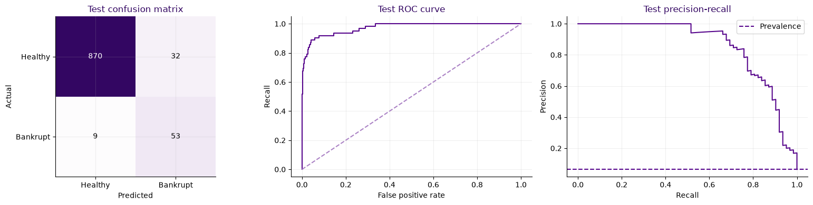

# Bankruptcy Risk Modeling

**An end-to-end financial risk study that optimizes decisions under asymmetric error costs.**

Predict next-year corporate bankruptcy from financial statements, audit the inputs, engineer liquidity and leverage features, and select a decision policy using training-only validation. The project connects model quality to an explicit risk trade-off: a missed bankruptcy costs five units; a false alarm costs one.

The frozen histogram gradient boosting model reduces test cost from **310 to 77**, a **75.2% reduction** versus predicting every company healthy. It detects **53 of 62 bankruptcies**, with **32 false alarms**, on the original 964-company test split. This is an academic research result under illustrative cost weights, not evidence of realized financial savings or production lending performance.

## Results

| Metric | Majority baseline | Frozen model |
|---|---:|---:|
| Cost: 5 × FN + FP | 310 | **77** |
| Cost per company | 0.3216 | **0.0799** |
| Bankruptcy recall | 0.0% | **85.5%** |
| Precision | Undefined: no positive predictions | **62.4%** |
| Accuracy | 93.6% | **95.7%** |
| Average precision (AP) | 0.0643 (constant score) | **0.8571** |
| ROC-AUC | 0.5000 (constant score) | **0.9726** |
| Brier score | — | **0.0220** |

Confusion matrix: **TN = 870, FP = 32, FN = 9, TP = 53**. The threshold is **0.15**, embedded in the prediction pipeline. AP is scikit-learn's average precision, not trapezoidal PR-AUC. Reference matching and prediction contracts are checked by the execution script; fresh evidence is documented in [reproducibility](docs/REPRODUCIBILITY.md).



## What the project demonstrates

- **Financial reasoning:** audit supplied ratios and monetary units; construct leverage, margin, cash coverage, quick-asset coverage, and short-debt features. A 365 conversion for inventory and receivables is internally supported by turnover relationships, with explicit accounting limitations.
- **End-to-end ML:** split before exploration; compare majority, logistic regression, Naive Bayes, KNN, decision tree, random forest, and boosting; keep learned preprocessing inside pipelines.
- **Decision-focused evaluation:** optimize `5 × FN + FP` and compare cost, AP, recall, precision, calibration, and ranking quality. No oversampling or class weighting is used in the final model.
- **Statistical discipline:** keep exact duplicate financial profiles together within development folds; compare procedures with nested grouped validation, matched search budgets, repeated fold arrangements, calibration and feature ablations, and a label-permutation association check.
- **Failure analysis:** inspect out-of-fold residuals and missed-bankruptcy subgroups; test sensitivity to missingness and evaluate unlabeled distribution changes without claiming holdout accuracy.

## Method

1. Reserve a stratified 20% test split (`random_state=42`): 3,854 training rows and 964 test rows from 4,818 labeled companies. The initial development subset has 2,891 rows.
2. Audit raw amounts, ratio consistency, missingness, and financial relationships on training data. Exclude `Id` from features.
3. Compare representations, imputation strategies, and model families. Evaluate proposed improvements using grouped training folds.
4. Compare feature candidates with matched eight-setting searches, then assess a 24-setting capacity search. Choose classifier settings and cutoff inside three grouped inner folds; compare on two five-fold outer arrangements.
5. Freeze the recipe, refit training rows, report final test metrics and uncertainty, and run prediction/distribution checks on 1,092 unlabeled companies.

Final pipeline: normalized financial features plus six liquidity relationships → fold-fitted correlation filter (0.995) → median imputation and missingness indicators → signed logarithm → histogram gradient boosting → fixed cutoff. The fitted model uses **59 financial columns and 57 missingness indicators**, 150 iterations, seven leaves, learning rate 0.05, L2 penalty 0.1, minimum leaf size 20, and feature fraction 0.7.

## Reproduce

Python **3.11** is the checked environment. Create an environment and install the pinned dependencies:

```bash
python -m venv .venv
# Windows PowerShell
.venv\Scripts\Activate.ps1
# macOS/Linux: source .venv/bin/activate
python -m pip install -r requirements.txt
python -m ipykernel install --user --name bankruptcy-risk --display-name "Bankruptcy Risk"
```

Both original CSV files are included in this public repository under `data/`. Their checksums, dimensions, and schema are validated by the project checks; see [data/README.md](data/README.md). From the repository root:

```bash
python scripts/check_project.py
python scripts/reproduce.py --data-dir data --kernel bankruptcy-risk --mode final
```

A clean Windows environment installation, dependency check, and final rebuild passed. `requirements-lock.windows.txt` records all resolved dependencies for that environment; use `python -m pip install -r requirements-lock.windows.txt` on Windows for the full lock. The shorter `requirements.txt` pins direct project dependencies.

The short route refits the frozen model in a fresh kernel and checks the headline results; it does **not** rerun the searches that originally selected that model. To execute all research experiments:

```bash
python scripts/reproduce.py --data-dir data --kernel bankruptcy-risk --mode full
```

Both the final route and the complete 50-code-cell research replay passed locally. Full execution is substantially more expensive. Both routes validate input hashes and use an empty temporary working directory. Outputs go to the ignored `reports/` directory. To run the notebook interactively, launch `jupyter lab` from the repository root and select the installed kernel. The notebook reads the included `data/` directory; set `BANKRUPTCY_DATA_DIR` only to override that location. Run cells top to bottom.

## Reading guide

```text
notebooks/bankruptcy_risk.ipynb  Full research narrative and methodology
scripts/reproduce.py            Fresh-kernel final/full execution and reference checks
scripts/check_project.py        Notebook, code, and release-content checks
results/                       Aggregate verified metrics, plot, input fingerprints
docs/METHODOLOGY.md             Validation design and statistical interpretation
docs/REPRODUCIBILITY.md         What was checked, environment, and execution scope
docs/DATA_AND_PROVENANCE.md     Origin, privacy, redistribution, and preservation notes
docs/PUBLISHING.md              GitHub publication status and update instructions
data/                          Included training/holdout CSVs and input contract
ci/validate.yml                Inactive GitHub Actions template; see publishing notes
```

## Limits and next steps

The original random split places **11 test financial profiles in training**. Excluding those rows from the same frozen predictions leaves cost **77**, recall **85.2%**, and AP **0.8534** on 953 rows. This sensitivity check is useful, but it does not replace a new group-disjoint or time-based external test.

Many experiments reuse the same training population; repeated nested comparisons do not erase prior exploration. Their repeated rows are not independent observations. Recorded nested cost falls from 875 to 849 across two arrangements (7,708 row-evaluations), a modest gain rather than independent evidence of future performance. The descriptive row-bootstrap 95% intervals are approximately **159–304 cost units saved** and **76.1%–93.8% recall**; they condition on the frozen model and do not capture model-selection uncertainty or profile dependence.

Missingness could encode distress or collection practices. Unlabeled holdout flag rates cannot establish predictive quality. Deployment would require independently sourced data, documented licenses and lineage, temporal/entity-disjoint validation, calibration under the target population, and costs tied to the actual decision process. These are future work, not completed claims.

## Repository checks

Run `python scripts/check_project.py` locally to validate notebook structure, recorded metrics, included data fingerprints/schema, and release content. `ci/validate.yml` is an inactive GitHub Actions template. The publishing credential lacks workflow permission, so automated GitHub checks are not enabled. An authorized maintainer can activate it by placing it at `.github/workflows/validate.yml`.

## Provenance and publication

Adapted from a completed academic bankruptcy-prediction notebook. This repository preserves the original split, feature formulas, selected model, threshold, and verified results while removing grading instructions and course scaffolding. It does not imply affiliation with any employer. This repository is public and includes the original CSV inputs at the owner's explicit request. Data redistribution rights and underlying course-material rights remain unverified; original coursework archives and local execution reports are excluded. The owner authorized public visibility on November 2, 2026. See [provenance](docs/DATA_AND_PROVENANCE.md) and the [publishing notes](docs/PUBLISHING.md). No open-source license is asserted pending a rights review.
